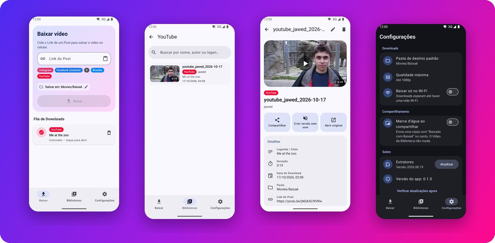
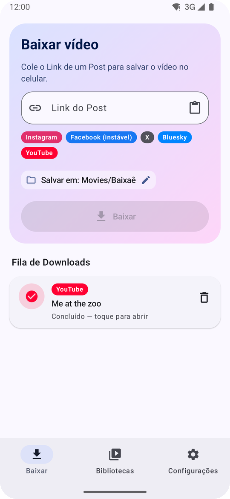
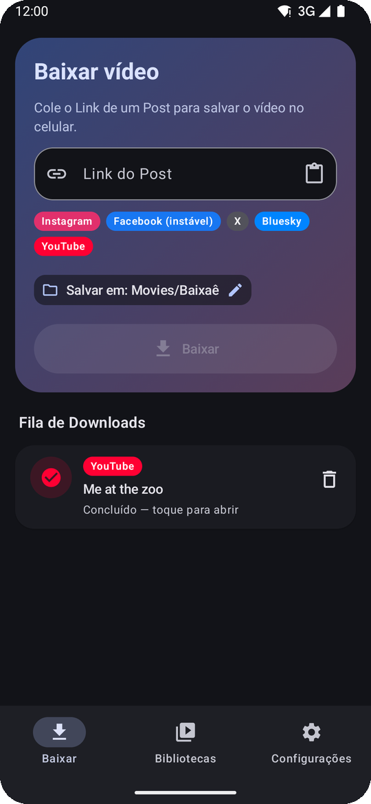
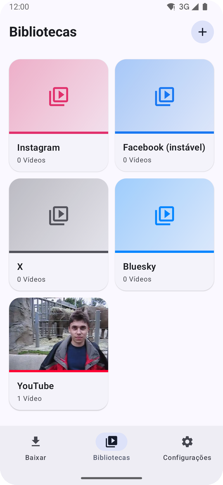

<p align="center">
  
</p>

<p align="center">
  <a href="../../releases/latest"></a>
  
  
</p>

<p align="center">
  
  
  
  
  
</p>

<h3 align="center">
  Viu um vídeo massa? Copia o link, abre o Baixaê, e pronto: tá no seu celular. 🇧🇷
</h3>

<p align="center">
  Gratuito, de código aberto, sem conta, sem anúncios e sem servidor no meio do caminho.<br>
  Tudo acontece no seu próprio celular.
</p>

<p align="center">
  <a href="#-o-que-ele-faz">O que ele faz</a> •
  <a href="#-plataformas">Plataformas</a> •
  <a href="#-instalação">Instalação</a> •
  <a href="#-perguntas-frequentes">Perguntas</a> •
  <a href="#-para-desenvolvedores">Desenvolvimento</a>
</p>

---

<p align="center">
  
</p>

## ✨ O que ele faz

<table>
  <tr>
    <td width="50%" valign="top">
      <h4>📋 Cola e baixa</h4>
      Copiou um link? O Baixaê percebe sozinho e pergunta se você quer baixar. Ou cole na aba <b>Baixar</b>, com um toque no botão de colar.
    </td>
    <td width="50%" valign="top">
      <h4>📤 Direto do menu Compartilhar</h4>
      No Instagram, no X ou no YouTube, toque em <b>Compartilhar → Baixaê</b>. O Download começa sem nem abrir o app.
    </td>
  </tr>
  <tr>
    <td valign="top">
      <h4>⏳ Fila que não para</h4>
      Mande vários de uma vez: a <b>Fila de Downloads</b> baixa dois por vez e continua com o app fechado, esperando o Wi-Fi se você quiser.
    </td>
    <td valign="top">
      <h4>📚 Tudo organizado</h4>
      Cada Vídeo cai na <b>Biblioteca</b> da sua Plataforma. Crie Bibliotecas suas, mova, renomeie e ache qualquer vídeo pela busca.
    </td>
  </tr>
  <tr>
    <td valign="top">
      <h4>🔇 Versão sem som</h4>
      Precisa só da imagem? Gere uma cópia muda em segundos, sem recodificar e sem perder o original.
    </td>
    <td valign="top">
      <h4>💧 Marca d'água opcional</h4>
      Ao compartilhar, dá para mandar uma cópia com "Baixado com Baixaê" no canto. O vídeo da sua Biblioteca continua limpo.
    </td>
  </tr>
  <tr>
    <td valign="top">
      <h4>🎚️ Você escolhe a qualidade</h4>
      Até 1080p por padrão, ou a máxima disponível. Vídeos em pé (Reels, Shorts) mantêm a resolução cheia.
    </td>
    <td valign="top">
      <h4>🔄 Sempre em dia</h4>
      As redes mudam o tempo todo. O Baixaê atualiza os extratores sozinho toda semana e avisa quando sai versão nova do app.
    </td>
  </tr>
</table>

<p align="center">
  
  &nbsp;&nbsp;
  
  &nbsp;&nbsp;
  
</p>
<p align="center"><sub>Tema claro e escuro, e no Android 12+ as cores acompanham o seu papel de parede.</sub></p>

## 🌐 Plataformas

| | Plataforma | O que baixa |
| :---: | --- | --- |
| 📸 | **Instagram** | Posts, Reels e carrosséis públicos (só os vídeos; fotos são ignoradas) |
| 🎬 | **YouTube** | Vídeos, Shorts e lives já encerradas |
| ✖️ | **X** (antigo Twitter) | Links de `x.com` e `twitter.com` |
| 🦋 | **Bluesky** | Posts públicos com vídeo |
| 👍 | **Facebook** | ⚠️ **Instável**: os Downloads falham com frequência |

> [!NOTE]
> Não funcionam: Threads (o yt-dlp ainda não tem extrator), Posts privados, conteúdo restrito por idade e stories, porque todos exigem login.

## 📲 Instalação

> [!IMPORTANT]
> O Baixaê **não está na Google Play**: as regras da loja não permitem apps que baixam vídeos dessas Plataformas (veja o [ADR-0001](docs/adr/0001-distribuicao-fora-da-play-store.md)). Ele é distribuído como APK pelo GitHub Releases.

1. **Descubra a arquitetura do seu celular.** Quase todos os atuais são **arm64-v8a**; aparelhos antigos ou muito simples podem ser **armeabi-v7a**. Apps como "CPU-Z" ou "Droid Hardware Info" mostram isso.
2. **Baixe o APK** da sua arquitetura na página de [Releases](../../releases/latest):

   | Arquivo | Para quem |
   | --- | --- |
   | `Baixae-<versão>-arm64-v8a.apk` | 📱 Celulares atuais (64 bits) |
   | `Baixae-<versão>-armeabi-v7a.apk` | 📟 Celulares antigos (32 bits) |
   | `Baixae-<versão>-x86_64.apk` | 💻 Emuladores e Chromebooks |

3. **Abra o APK no celular.** Na primeira vez, o Android pede para **permitir a instalação de apps desta fonte** (o navegador ou o gerenciador de arquivos). Permita e volte para instalar.
4. Pronto! Requer **Android 8.0** ou mais novo.

Para atualizar, instale o APK da versão nova por cima da antiga: seus Vídeos e Bibliotecas continuam lá. O próprio app avisa quando há versão nova.

## ❓ Perguntas frequentes

<details>
<summary><b>Um Download falhou dizendo que a Plataforma mudou. E agora?</b></summary>
<br>
As Plataformas mudam com frequência. Toque em <b>Atualizar extratores e tentar de novo</b> no próprio Download. O app também atualiza os extratores sozinho uma vez por semana, e você pode forçar em <b>Configurações → Extratores</b>.
</details>

<details>
<summary><b>Onde ficam os vídeos?</b></summary>
<br>
Em <code>Movies/Baixaê</code>, visíveis na galeria do celular. Dá para trocar a pasta padrão em Configurações, ou só para um Download, direto na aba Baixar.
</details>

<details>
<summary><b>Preciso fazer login em alguma rede?</b></summary>
<br>
Não. O Baixaê só baixa conteúdo público e nunca pede suas senhas. Por isso Posts privados, stories e vídeos restritos por idade não funcionam.
</details>

<details>
<summary><b>O app manda meus dados para algum lugar?</b></summary>
<br>
Não. A extração roda no próprio celular, com o <a href="https://github.com/yt-dlp/yt-dlp">yt-dlp</a>. Nenhum servidor nosso participa dos Downloads. O app só consulta o GitHub para saber se há versão nova e para atualizar os extratores.
</details>

<details>
<summary><b>Por que o APK é tão grande?</b></summary>
<br>
Ele leva junto um Python, o yt-dlp e o ffmpeg, para tudo funcionar offline no celular, sem servidor. Por isso há um APK para cada arquitetura: cada um traz só o que o seu celular usa.
</details>

## 🛠️ Para desenvolvedores

```
Baixaê
├── core/   Regras do app em Kotlin puro (sem Android), cobertas por testes
└── app/    App Android em Jetpack Compose: liga o núcleo ao yt-dlp, MediaStore, Room e WorkManager
```

- O núcleo segue **portas e adaptadores**: tudo que toca o mundo (extrator, armazenamento, banco, relógio, rede) é uma porta, com fakes nos testes.
- Testes do núcleo: `./gradlew :core:test` · App de depuração: `./gradlew :app:assembleDebug`
- Extração via [youtubedl-android](https://github.com/yausername/youtubedl-android) (yt-dlp + Python + ffmpeg + QuickJS).
- Vocabulário do domínio em [`CONTEXT.md`](CONTEXT.md); decisões de arquitetura em [`docs/adr/`](docs/adr/).
- Como publicar uma versão: [`docs/publicacao.md`](docs/publicacao.md).

Contribuições são bem-vindas! Abra uma issue contando o que quer mudar antes de mandar um PR grande.

## 📜 Licença

[GPL-3.0](LICENSE). Componentes de terceiros e suas licenças estão em [`THIRD_PARTY_NOTICES.md`](THIRD_PARTY_NOTICES.md).

> [!CAUTION]
> Baixe apenas conteúdo que você tem direito de guardar. Respeite os direitos dos autores e os termos de uso de cada Plataforma.

<p align="center">
  <br>
  <sub>Feito no Brasil com ☕ e muito vídeo de gatinho.</sub>
</p>
